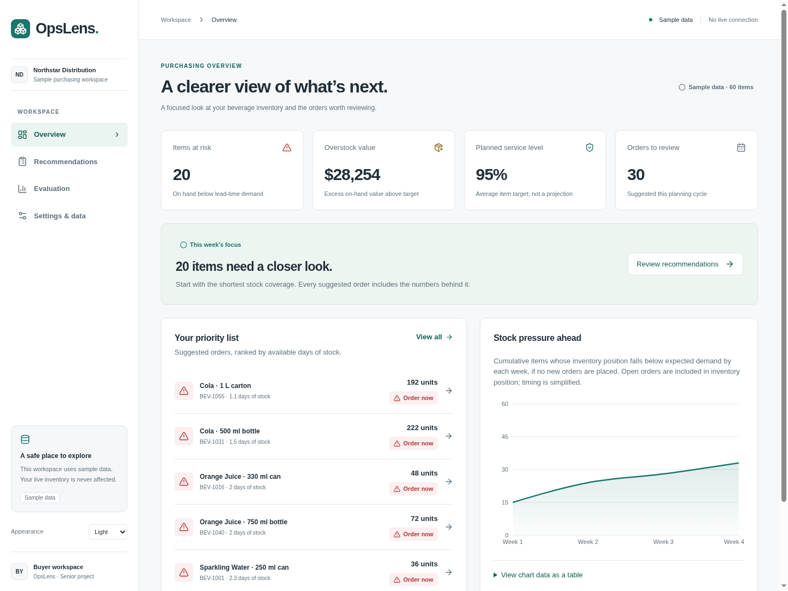

# OpsLens

A frontend purchasing workspace for SMB distributors. **Stages 1–7 are implemented using sample data only.** OpsLens helps a buyer review what to order, how much, and why. There is no backend, authentication, live Dynamics GP connection, or trained forecasting model in this prototype.



## Run

Requires Node.js **22.12+ or 24** and npm. From this repository’s root:

```sh
npm install
npm run dev
```

Open the address printed by Vite. In GitHub Codespaces, open the browser link for port **5173** in the Ports tab. For a reproducible install, use `npm ci` with the committed lockfile. To check or serve the production build:

```sh
npm test
npm run build
npm run preview
```

`npm test` runs Vitest once. The app uses browser-history routing: a future production host must serve `index.html` for screen routes. No deployment configuration is included.

## What works

| Screen                             | Workflow                                                                                                                                                                             |
| ---------------------------------- | ------------------------------------------------------------------------------------------------------------------------------------------------------------------------------------ |
| Overview `/`                       | Risk, overstock value, average service target, order counts, priorities, and an illustrative stock-pressure chart.                                                                   |
| Recommendations `/recommendations` | Search by item/SKU, filter timing and supplier, sort columns, select visible rows, and export a review CSV. Click a row or its item link for details.                                |
| Item `/items/bev-001`              | Daily demand history, an illustrative P10–P90 fan band, snapshot stock references, planning inputs, explanation math, and an immediate service-target preview with failure rollback. |
| Evaluation `/evaluation`           | A held-out sample replay comparing the OpsLens rule, weekly seasonal naive, and a standard reorder-point rule, with comparison charts and metric definitions.                        |
| Settings `/settings`               | System/light/dark appearance, simulated source test, local CSV validation/preview, and a disabled GP option explaining future read-only access.                                      |
| Interface preview `/ui`            | Shared components and loading/empty/error examples, without inventory records.                                                                                                       |

All query-driven screens have skeletons, empty states, and retry actions. Risk badges use icons and labels. Tables support keyboard sorting/selection, charts include text explanations and data-table alternatives, and the mobile drawer supports focus containment and Escape. Evaluation includes print styles for a presentation handout. This is a practical accessibility pass, not a formal WCAG certification.

## Sample data and honest limits

- 60 reproducible beverage items across five suppliers; 20 initially at risk, 20 healthy, and 20 overstocked. Fixed snapshot: **November 2, 2026**; forecast dates start the following day. Workspace identity is illustrative.
- Mock responses have 250 ms latency and a seeded 2% failure rate. To avoid interruptions during a defense, create `.env.local` with `VITE_MOCK_ERROR_RATE=0`. Use `1` to force error/retry states. Restart Vite after changes.
- Service targets (90/95/98/99%) affect only the current sample session and reset on refresh. The UI updates optimistically, then confirms or rolls back. Past evaluation results do not change when an item’s target changes.
- The dashboard’s planned service level is the average configured target, **not** projected or measured performance. Stock pressure assumes no new orders and simplified open-order timing.
- The forecast mean is a P50 proxy; normal-approximation ranges are **not calibrated for intermittent demand**. Stock and reorder-point lines are snapshot references, not projected balances. Holding cost is displayed but does not optimize the sample ordering rule.
- The sample backtest is a transparent policy simulation, not real model output. Its service metric is unit fill rate, different from the item’s cycle-service target. Stock-out days count **item-days**; holding cost excludes purchases and shortage costs.
- CSV uploads are checked only in the browser (1 MB / 2,000 rows, columns `sku,name,onHand`); the first five rows are previewed. They are not uploaded, persisted, or used for recommendations. CSV exports never place orders. GP cannot be selected or contacted.

See [API contract, formulas, assumptions, and endpoints](src/api/README.md) for the detailed defense explanation. Changing `VITE_API_BASE_URL` switches the client to HTTP without changing screens; a backend must implement that documented contract and appropriate CORS. The immediate what-if preview currently uses the shared sample rule, so a future backend should keep its preview policy aligned or replace that calculation within the API/query layer. Never put credentials in public `VITE_` variables.

## Team structure

| Folder            | Responsibility                                                                                              |
| ----------------- | ----------------------------------------------------------------------------------------------------------- |
| `src/api/types/`  | Shared backend response contracts and units. Agree on these first.                                          |
| `src/api/`        | Client interface, HTTP adapter, singleton selection, query hooks, mutations, and cache management.          |
| `src/api/mock/`   | Seeded histories/forecasts, sample server state, and historical replay.                                     |
| `src/components/` | Buttons, cards, badges, tooltips, table, chart frame, loading/empty/error states, and theme provider.       |
| `src/features/`   | One owner/folder per screen; `interface-preview` is a component showcase.                                   |
| `src/lib/`        | Formatting, CSV export/preview, seeded randomness, and the shared sample recommendation policy.             |
| `src/styles/`     | `tokens.css`: design tokens; `components.css`: shared UI; `features.css`: screens; `app.css`: layout shell. |
| `docs/`           | Screenshots and the [three-minute demo script](docs/demo-script.md).                                        |

For four teammates, split API/types, shared UI, purchasing screens, and evaluation/settings. Screens use query hooks and never import the mock generator. Keep shared response types and tokens coordinated. Routes are lazy-loaded so chart libraries do not all land in the initial bundle.

## Validation

The tests cover seeded data, order arithmetic and pack rounding, service-target monotonicity, filtering, latency/failures, HTTP request encoding/errors, CSV parsing/export, table sorting/selection, tooltips, theme/navigation, recommendation export/retry, what-if updates/rollback, and simulated source testing. Run `npm test` and `npm run build` before review.

Chromium checks exercise every main screen at 1440 px and 390 px, confirm charts render and the document has no horizontal overflow, and verify the mobile drawer’s focus/Escape behavior. These are targeted checks rather than an exhaustive device or assistive-technology audit.

## Screenshots

[Recommendations](docs/screenshots/recommendations.png) · [Item detail](docs/screenshots/item-detail.png) · [Evaluation](docs/screenshots/evaluation.png) · [Settings](docs/screenshots/settings.png) · [Dark dashboard](docs/screenshots/dashboard-dark.png) · [Mobile dashboard](docs/screenshots/dashboard-mobile.png) · [Mobile recommendations](docs/screenshots/recommendations-mobile.png)

## Future backend work

Implement the API contract, validated GP/CSV ingestion, calibrated probabilistic forecasts, order-policy optimization, and real out-of-sample evaluation in a separate backend project. This frontend makes no claim that those capabilities have been built or validated.
